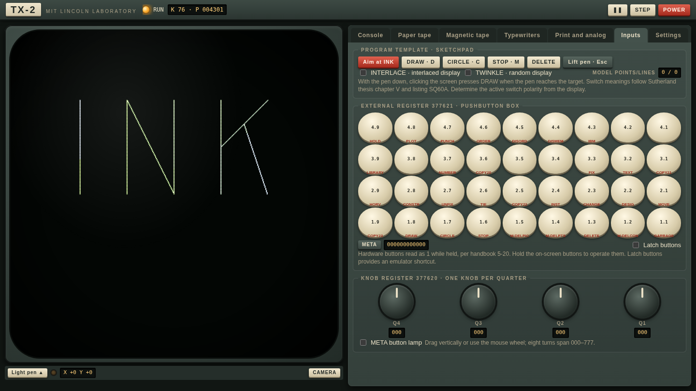

# TX-2 Replica

A Verilog recreation of MIT Lincoln Laboratory's 36-bit TX-2 computer, with a native command-line simulator and a WebAssembly console.

[Open the browser emulator](https://tx-2.cli.tf/)

The **GitHub** badge in the console header links back to this repository.



*The INK startup screen of Ivan Sutherland's 1963 Sketchpad, rendered from the program's CRT output.*

## Quick start

Install Git, GNU Make, Python 3, Verilator, and the Emscripten SDK. Put `em++` on your PATH or install the SDK at `work/emsdk`. The build fetches the pinned upstream repositories used by the tape library.

```sh
make browser
```

1. Open [the local console](http://127.0.0.1:8002/) in your browser.
2. Under **Paper tape**, find **Sketchpad · 1963** and select **Load and start**. Wait for INK to appear on the CRT.
3. Open **Inputs** and select **Aim at INK**. Move the pointer over the CRT and click to draw. Press **M** to stop drawing or **Esc** to lift the pen.

For **Inchworm · 1958**, select **Load and start** in the same tape library. The program copies itself through core memory without drawing to the CRT. Watch the octal **P** (program counter) in the console header, or use **STEP** to follow individual instructions.

### Handwritten digits

In **Paper tape**, choose **Handwritten Digits · Neural network → Load and start**. Wait for the dot grid to appear, then hold and drag on the CRT to write a single digit. Lift the pen between strokes. Press **Enter** (or **Recognize**) to draw the predicted digit on the right side of the CRT. Press **Delete** (or **Clear**) before writing another digit. The on-screen buttons also work on touch devices.

The TX-2 program samples the light pen through sequence 55 and stores a 16×16 bitmap in core. It fits the occupied area into an 8×8 grid, then runs a **64 → 32 → 10** integer neural network with a ReLU hidden layer. The quantized model scored **93.61%** on the official MNIST test set after the same grid normalization; that benchmark is not a guarantee for individual light-pen strokes.

The ready-to-boot tape is `programs/digits.tape`. To verify native pen input, inference and CRT output, run `make digits-check`. To regenerate the tape, run `make digits` with the upstream `tx2m4as` built (or set `TX2_ASSEMBLER` to its path). Offline retraining is optional: `python3 tools/train_digits.py` needs NumPy and PyTorch and downloads the [MNIST dataset](https://huggingface.co/datasets/ylecun/mnist) archives.

## Scope

The model covers the 36-bit instruction set, sequence control, memory, and device I/O. The browser console exposes the CRT, light pen, paper tape, and Lincoln Writer, among other peripherals. The recreation targets functional behavior. Pulse-level timing and FPGA deployment remain future work.

For native use, `make cli` builds `build/obj_cli/tx2-cli` with a GNU C++17 toolchain. Run `make check` for RTL simulation, lint, and synthesis checks with Icarus Verilog, Verilator, and Yosys with ABC.

## Documentation

- [Implementation status and validation](docs/RTL-STATUS.md)
- [Historical manuals and source listings](docs/PRIMARY-SOURCES.md)
- [Sketchpad reconstruction manifest](programs/sketchpad/manifest.json)

## Acknowledgments

This project would not exist without the contributions of the TX-2 Project. Its Rust simulator served as a reference, its M4 cross-assembler helped us rebuild Sketchpad, and its documentation index led us to original sources. The browser also uses its HELLO example tape and draws on its Lincoln Writer character mapping. Special thanks to James Youngman for his work on the cross-assembler and for making early Lincoln Laboratory progress reports and *The Lincoln Writer* available online. [TX-2 Project](https://tx-2.github.io/) · [Simulator and assembler](https://github.com/TX-2/TX-2-simulator) · [Documentation index](https://tx-2.github.io/documentation/) · [Progress reports](https://tx-2.github.io/documentation/ll-progress-reports)

Thanks to chief architect Wesley A. Clark and the MIT Lincoln Laboratory team for designing and documenting the TX-2. The three-volume 1961 *TX-2 Technical Manual* (LM-44) and the 1961 and 1963 copies of the *TX-2 Users Handbook*, edited by Alexander Vanderburgh Jr., guided the processor, paper-tape bootstrap, and device interfaces. We used the 1958 *Circuitry Handbook* (6D-2631), laboratory progress reports, and TX-2 user memos to trace hardware behavior and revisions. Gilmore and Savell's *The Lincoln Writer* (Group Report 51-8) and Best and Stockebrand's paper on fixed-address magnetic tape supplied additional peripheral details. [Hardware notes](docs/HARDWARE-READING.md) · [Users Handbook](https://tx-2.github.io/documentation/#UH) · [Lincoln Writer report](https://archive.org/details/ad-0235247) · [Magnetic tape references](references/device-specs/magnetic-tape.md)

Thanks to Ivan Sutherland for writing Sketchpad and supplying the original program listing. His 1963 report, *Sketchpad: A Man-Machine Graphical Communication System* (TR-296), helped us interpret the display and light-pen controls. Jurij Smakov's transcription for the TX-2 Project was the basis for our reconstruction, which we checked against the Computer History Museum's scans of both parts of the listing. [TR-296](https://tx-2.github.io/documentation/#sketchpad) · [Transcription and provenance](https://github.com/TX-2/Sketchpad#origin-and-format) · [Program listing, part 1](https://github.com/computerhistory/Historical-Highlights-Documents-Repository/blob/main/Sketchpad%20Pt%201%20102726903-05-01-acc.pdf) · [Part 2](https://github.com/computerhistory/Historical-Highlights-Documents-Repository/blob/main/Sketchpad%20Pt%202%20102726903-05-02-acc.pdf)

Thanks to Bitsavers for preserving scans of the manuals and technical reports and to Your.org for hosting the Bitsavers mirror used for this research. Thanks also to the Retro-Computing Society of Rhode Island for making the 1961 handbook and user memos available, and to Internet Archive for the laboratory reports, page images, and searchable OCR. [Bitsavers mirror](https://ftpmirror.your.org/pub/misc/bitsavers/pdf/mit/tx-2/) · [RCS/RI TX-2 library](https://www.rcsri.org/library/tx2/index.shtml) · [Source catalog](docs/PRIMARY-SOURCES.md)

## License

Original TX-2 Replica code and documentation are available under the MIT License. Historical material, upstream components, and linked runtimes have separate terms. [MIT License](LICENSE) · [Third-party notices](THIRD_PARTY_NOTICES.md)
