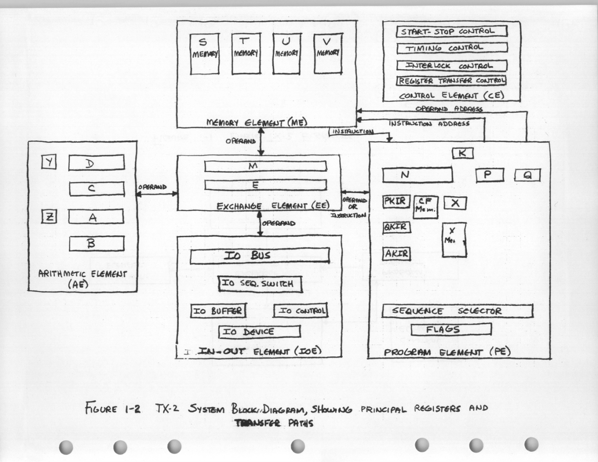
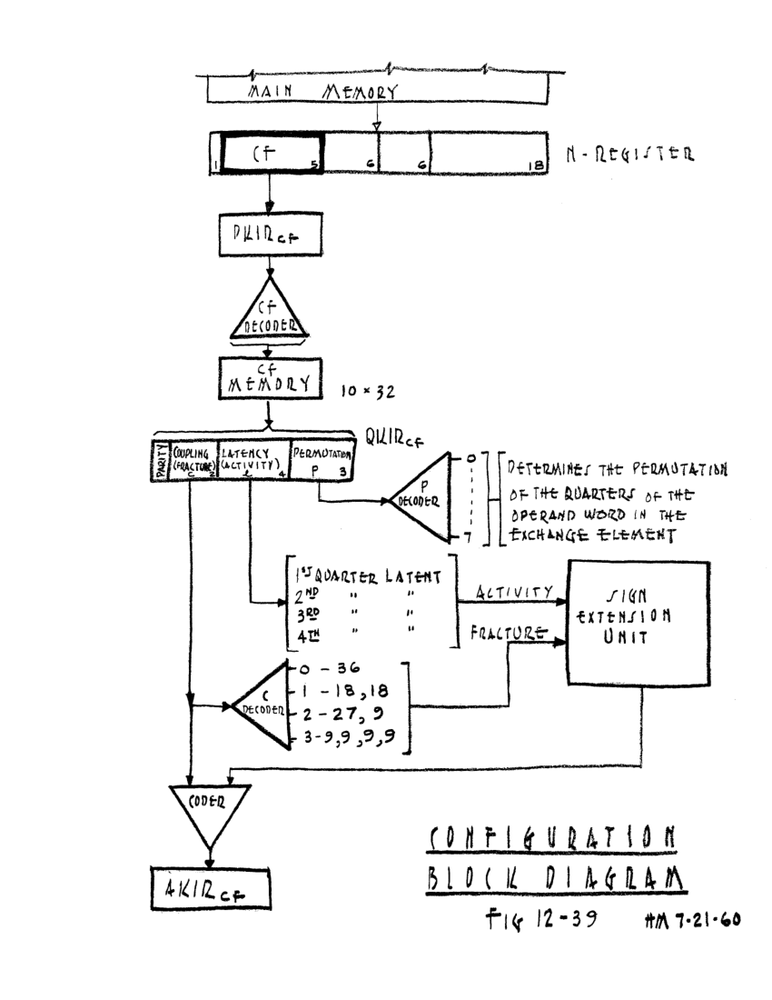

# TX-2 primary hardware sources and architecture analysis

Date: 2026-11-10. The available scans support register-transfer-level design grounded in original sources. This review established the overall architecture, configuration path, sequence switching, memory overlap, and the main LDA/TSD execution steps. Instruction-by-instruction timing, complete circuit netlists, and all historical revisions require further review.

The 5,346 collected pages describe the size of the source library. The sections below identify material actually read and checked. Other documents have extracted text, indexes, and classifications. See [PRIMARY-SOURCES.md](PRIMARY-SOURCES.md) for the full inventory. Code paths are relative to the repository root.

## 1. Primary evidence examined

PDF page numbers are one-based and match the reader page count. Printed page numbers are recorded separately.

| Evidence | Location | Content checked |
| --- | --- | --- |
| Technical Manual vol. 1, Fig. 1-2 | [PDF p. 16](../references/pdfs/LM-44v1_TX-2_Technical_Manual_Volume_1_196105.pdf#page=16) | Six Elements, main registers, and transfer directions; original figure inspected |
| Vol. 1, §2-3.2/2-3.3 | PDF pp. 25–27, printed pp. 2-7 to 2-9 | X/F memory, 33 sequences, and switching steps |
| Vol. 1, §2-4 | PDF pp. 32–33, printed pp. 2-14/2-15 | S/T/U/V, destructive reads, and memory overlap |
| Vol. 1, §2-6 | PDF pp. 39–42, printed pp. 2-21 to 2-24 | A/B/C/D roles, partial sums and carries, independent arithmetic control |
| Vol. 1, Fig. 2-1 | [PDF p. 49](../references/pdfs/LM-44v1_TX-2_Technical_Manual_Volume_1_196105.pdf#page=49) | Original bit numbering and register widths; original figure inspected |
| Technical Manual vol. 2, §8-3.1 and §9-3 | PDF pp. 6/21, printed pp. 8-4/9-6 | α/β clock phases and the precise meaning of overlap |
| Vol. 2, §12-2.10.3 and §12-6 | PDF pp. 186/195–199, printed pp. 12-12 and 12-21 to 12-25 | Configuration values, expanded activity, and sign extension |
| Alternate vol. 2 scan, Fig. 12-39/40/45 | [PDF pp. 250/251/256](../references/pdfs/TX-2_TechManVol2_Jun61.pdf#page=250) | Configuration path, subword forms, and eight permutations; original figures inspected |
| Technical Manual vol. 3, LD- | [PDF pp. 86/88](../references/pdfs/LM-44v3_TX-2_Technical_Manual_Volume_3_196107.pdf#page=86) | LDA description and handwritten micro-operation timing checked |
| Vol. 3, TSD | [PDF pp. 131/132/134](../references/pdfs/LM-44v3_TX-2_Technical_Manual_Volume_3_196107.pdf#page=131) | Splayed transfer, rotation, waiting, and retention of peripheral selection |
| 6D-2631, 1958 Circuitry Handbook | [PDF pp. 34–36 and 104](../references/pdfs/6D-2631_TX-2_Circuitry_Handbook_Oct1958.pdf#page=34) | Clock distribution, register drivers, high-speed flip-flops, and Fig. 40 circuit; original figures inspected |
| General Memos, 1965-01-25 | [PDF pp. 17–18](../references/pdfs/TX2-Memos-General_196407.pdf#page=17) | SKX behavior change; original inspected |
| Display Memos, 1964-10-05 | [PDF pp. 11–12](../references/pdfs/TX2-Memos-Display_196401.pdf#page=11) | Curve-display commissioning and interface; original inspected |

## 2. Connections between the six hardware Elements

The exported system diagram preserves the original content. Open the complete PDF for a larger view.

| Original name | Hardware and responsibilities | Verilog requirements |
| --- | --- | --- |
| Memory Element, ME | S/T core memory, reserved U, registers and fixed storage in V | Shared address space for instructions and operands; independent busy state for each bank |
| Program Element, PE | P/Q/N/K, X memory and adder, F configuration memory, instruction-control registers, sequence selector | Address formation, sequence scheduling, and configuration dispatch must be defined together |
| Exchange Element, EE | M and E, permutation, activity control, sign extension | E is a transfer hub with visible state; direction and inactive fields both affect transfers |
| Arithmetic Element, AE | A/B/C/D, Y/Z flags, segmented shift and carry connections | Parallel arithmetic in different subword forms, preserving intermediate state and segment flags |
| In-Out Element, IOE | I/O bus, device buffers and controllers, sequence switches | Device buffering and mechanical operations have independent timing and must request sequence service |
| Control Element, CE | Start/stop, counters, register-transfer pulses, interlocks | State transitions depend on memory, E, X, and arithmetic-unit busy conditions |

A typical path is `P address → memory instruction into N → indexing forms Q → memory operand into M → E configuration transform → A/B/C/D or I/O`. F memory controls the configuration transform. The sequence selector chooses the program supplying the next instruction.

## 3. Word length, bit numbering, and registers

The original machine groups bits into nine-bit quarters, with Q1 lowest and Q4 highest. Bit `2.6` is the sixth bit of the second quarter. Ordinary 36-bit data maps to zero-based RTL positions as `9×(quarter−1)+(bit−1)`. Additional bits such as `4.10` use special numbering and require separate representation.

| Component | Width and purpose from figures and text |
| --- | --- |
| S/T words, N, M | 36 data bits plus parity and meta; 38 physical bits |
| A, B, C, D, E | 36 data bits each; associated meta is handled through the corresponding V locations and control circuitry |
| X memory | 64×19 physical bits: 18 content bits plus parity; the X buffer also has parity |
| F memory / QKIR_CF | 32×10 physical bits: nine configuration bits plus parity |
| P | 17 address bits plus the sequence meta bit in Fig. 2-1; register width differs from physical address width |
| Q | Fig. 2-1 shows an 18-bit transfer path; memory address interpretation uses its address portion |
| K | Six-bit current sequence number |
| PKIR_CF | Holds the instruction's five-bit configuration field |
| AKIR_CF | Six bits in the figure: two fracture bits and four expanded activity bits; AE does not use the three permutation bits |

The final item is corroborated by the transfer description on vol. 2 PDF p. 186 and vol. 1 PDF p. 42: QKIR_CF9–8 supplies fracture, and the expanded-activity network supplies AKIR_CF7–4. Treating the entire nine-bit configuration word as the AE control register would omit this transformation.

## 4. Configuration comprises three related hardware controls

Instructions using F memory follow `five-bit CF in N → PKIR_CF → one of 32 F entries → nine-bit F value → QKIR_CF`. Some control instructions interpret CF directly and require opcode-specific definitions.

The nine-bit value has three components:

- CF9–8 selects fracture. Table 12-1 defines 00 as 36, 01 as 18+18, 10 as 27+9, and 11 as 9+9+9+9.
- CF7–4 controls activity in the four quarters; zero marks a quarter active.
- CF3–1 selects one of eight permutations, with corresponding forward and inverse mappings for transfers to and from memory.

Activity and fracture affect results differently. A 36-bit subword with only its low nine bits active can sign-extend those bits across the full word. In 9+9+9+9 form, each nine-bit subword is independent. The arithmetic unit receives expanded activity: a partially active subword becomes fully active within AE.

These hand-derived examples use no permutation and octal values. They follow the manual rules and had not yet been verified as whole-machine execution results at this review stage:

| Initial A | Operand in M | Nine-bit configuration | A after LDA | Reason |
| --- | --- | --- | --- | --- |
| 111222333444 | 555666777000 | 340 | 111222777000 | 18+18; low half active, high half preserved |
| 111222333444 | 555666777400 | 160 | 777777777400 | 36-bit subword; only Q1 initially active; its set sign bit extends into higher bits |

## 5. LDA micro-operations

Vol. 3 PDF p. 86 gives seven steps, expanded into phases and register transfers on PDF p. 88:

1. Read the selected memory word into M. Core-memory reads destroy the stored content, requiring a later rewrite.
2. Transfer the old destination-register content into E to preserve inactive portions.
3. Inverse-permute E, merge M into E using the permuted activity range, then forward-permute E.
4. Extend signs according to subword form and activity. The diagram separates controlled clearing from subsequent complement pulses.
5. Transfer E to the selected A/B/C/D register.
6. The ultimate pulse copies the original operand M back into E.
7. Rewrite the original operand to memory. Non-destructive V storage follows a separate path.

Step six makes the final E value part of the LDA specification. In the first example above, final A is `111222777000`, while final E holds the original operand `555666777000`.

The inspected handwritten [timing diagram](../references/figures/vol3-p088.png) specifies the destination-to-E transfer at QK 11α, the configuration steps, E-to-destination writeback at QK 21α, and M→E with E-busy clearing at QK 23α.

## 6. Sequences and peripheral control

The 1961 vol. 1 §2-3.2/2-3.3 specifies 33 octal sequence numbers: `00` and `40…77`. All 64 X registers support indexing, but only those positions store sequence program counters.

K holds the current sequence number, and P holds its program counter. Suspended sequence counters reside in their X words. Switching reads the new sequence's X value into P and writes old P to the previous sequence's X position. Sequence 00 is special: X0 is fixed at zero, and its new starting point comes from the TSP toggle switches.

Device flags request service. The Priority Patch Panel establishes priority relationships, and hold/dismiss affects switching. The original switching description saves the program counter and related switching information. A/B/C/D remain shared resources governed by program conventions.

IOS selects, connects, disconnects, reports status, and operates flags. TSD transfers data to or from the device associated with the current K sequence. A busy device buffer can invoke dismiss-and-wait.

In paper-tape assembly mode, six six-bit lines form one 36-bit word through splayed input and rotation. Vol. 3 PDF pp. 131–134 also require blocking sequence switches that would change peripheral selection during execution and constrain other I/O pulses. This path provides a basis for investigating the earlier HELLO loading failure. This review did not attribute that failure to a specific step.

## 7. Clocks, overlap, and arithmetic paths

The 1958 Circuitry Handbook PDF p. 34 and the 1961 vol. 2 §8-3.1 both specify α and β phases with 0.4 μs periods, offset by 0.2 μs. Each phase runs at 2.5 MHz; alternating phases provide 0.2 μs event intervals. Interpret the vol. 1 specification of a 5 mc two-phase clock in this context.

PK controls instruction fetch and related addressing, QK controls the operand stage, AK controls longer arithmetic operations, and CSK controls sequence switching. FK and XWK handle F and X memory operations. Interlocks distinguish busy conditions for E, X, memory, and AE.

Overlap in §9-3 means overlapping the current operand-memory access with the next instruction-memory access. Different banks can operate concurrently when other interlocks permit; accesses contending for one bank must wait. Access time and complete read/write cycle time are separate: the 1961 table gives 4.0/6.4 μs for S and 2.0/4.4 μs for T.

AE's four main registers have distinct roles: A holds the accumulator and partial sum, B extends A for double-length data, C holds partial carries, and D holds the memory operand and participates in shift counts and other operations. The manual describes formation of partial sums and carries followed by complete carry propagation. Segmented coupling determines connections across quarter boundaries for shifts and carries.

AE has independent AKIR opcode and configuration control. Other instructions can therefore start during long arithmetic operations when interlocks permit. An initial RTL implementation can use conservative scheduling, with timing differences documented and interfaces retained for future overlap support.

## 8. Circuit-level evidence and electrical verification

The 1958 6D-2631 PDF p. 35 describes register driver No. 09 as a clock-pulse gate controlled by two level inputs. Pulses pass when both are at ground; either input at −3 V blocks them. Fig. 40 on PDF p. 104 shows the transistors, pulse input, and output.

PDF p. 36 describes RC coupling, clear/set/complement controls, output stages, and loading for high-speed flip-flop No. 01. The readable circuit diagrams can be connected to the higher-level register-driver equations.

Verilog can express conditional register transfers through phase conditions and enables. Original pulse amplitudes, cable loading, component tolerances, and analog delays require electrical models and separate simulation. Those checks were outside this review.

## 9. Revision and scan differences

| Finding | Original location | Implementation treatment |
| --- | --- | --- |
| The 1957 paper describes 32 program counters; the 1961 manual lists 33 sequences | WJCC PDF p. 14; vol. 1 PDF pp. 25–27 | Follow the sequence selector for the target period |
| Bound handbooks contain later replacement tables | Nov63 Handbook PDF p. 192 has the older configuration table; p. 193 has a February 1964/APEX table | Use dates within pages to choose configuration initialization |
| Fracture names have inconsistent numbering | Fig. 12-40 uses f0…f3; 1961 Table 12-1 uses f1…f4 with a different middle ordering | Use explicit CF encodings and bit ranges |
| SKX changed on 1965-01-25 | General Memos PDF pp. 17–18 | Define 1963 and 1965 semantics separately |
| Later memos announce the curve display | Display Memos PDF p. 11, 1964-10-05 | Implement target-period display protocols before adding later hardware |
| Vol. 2 scans cover different figures | LM-44v2 enters chapter 13 after PDF p. 232; the alternate scan has Fig. 12-39 through 12-49 on PDF pp. 250–260 | Use both scans and check chapter completeness after restoring figures |

Documents from different years require revision comparisons. Current evidence supports sourced Verilog control and data-path specifications. Final specifications still require resolving differences between tables, prose, figure numbers, and change notices.

## 10. Next specification work

For each M1 bootstrap instruction—SPG, SKX, IOS, TSD, JPX, JNX, and JMP—record input state, address formation, configuration handling, register changes, memory and I/O changes, interlock waits, alarms, and original page references. Validate the loading path with TSD paper-tape assembly vectors, then implement complete fetch and boot flows.

Sources support this work. Remaining material to locate includes the 1959 Introductory Notes, the 1960 SKX note, additional field change notices, and clear historical program samples. See the missing-material list in the source catalog.

## Additional checks during whole-machine implementation, 2026-11-10

- Vol. 3 PDF pp. 138–160 supplied arithmetic timing for CYCLE/SCALE, NORMALIZE, DSA, ADD/SUB, TLY, MUL, and DIV. MUL partial-add/multiply steps and DIV partial-add/complete-carry/final-remainder-correction steps were converted into synthesizable iterative logic. Mathematical multiply/divide results provide separate cross-checks.
- Vol. 2 §14-2.7, PDF pp. 298–299, defines direct AOP: the opcode comes from N2.6–2.1 and the configuration from N1.9–1.4. It reuses AE registers and skips the operand cycle. AOP does not expand activity as ordinary instructions do, so shifts can receive frozen coupling bits from inactive quarters.
- Vol. 2 Fig. 10-42 and the vol. 3 ASK preset table were located. All-zero normalization and uncommon partial-activity AOP combinations still require pulse-level comparisons. The current register-length bound is a rule awaiting calibration and is recorded in RTL status.
- Nov63 Handbook PDF p. 138 defines standard priority in ascending numerical order, with lower sequence numbers first. The default priority wiring follows this rule.
- PDF p. 93 defines nine MISAL/EIA report bits for device 41. PDF pp. 95–96 define instruction, defer, operand, and sequence traps; three forms of meta setting; and external synchronization.
- Visual inspection of the original PETR diagram on PDF p. 105 confirmed run bit 100, assembly bit 2, and bin-load bit 4. Commands 30100 and 30102 require distinct normal and assembly behavior. Display-origin modes and the timer run bit also require device-specific interpretation.
- Display coordinates on PDF pp. 111–112 are X=4.9–3.9 and Y=2.9–1.9, in ten-bit ones-complement form. Origin positioning complements the corresponding sign bits. Four intensification levels last 10/20/40/80 μs. Dedicated interfaces and paper-tape graphics diagnostics verified these digital paths.
- The standard plugboard loads the 20-word reader leader into octal locations 3–26. Nonfinal tape blocks must link back to 3 and use an 18-bit ones-complement end-around checksum. The original program checks these words in RTL; the reader leader remains in the boot path.

Runnable targets, logs, and known limits are documented in [RTL-STATUS.md](RTL-STATUS.md).
